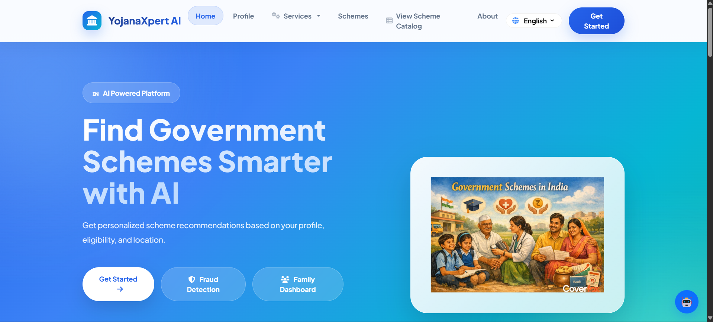

# YojanaXpert AI – Smart Government Scheme Recommendation System

YojanaXpert AI is an intelligent government scheme recommendation platform designed to help citizens discover welfare schemes they may be eligible for. The system analyzes user information such as age, income, occupation, gender, location, and social category to generate personalized scheme recommendations.

The platform simplifies access to government benefits by integrating Artificial Intelligence (AI), Machine Learning (ML), voice assistance, fraud detection, and an intuitive user interface into a centralized solution.

## Table of Contents

- [Overview](#overview)
- [Problem Statement](#problem-statement)
- [Project Screenshots](#project-screenshots)
- [Key Features](#key-features)
- [System Architecture](#system-architecture)
- [Technology Stack](#technology-stack)
- [Project Modules](#project-modules)
- [Workflow](#workflow)
- [Project Highlights](#project-highlights)
- [Future Enhancements](#future-enhancements)
- [Disclaimer](#disclaimer)

## Overview

Government welfare schemes provide financial assistance, healthcare benefits, educational support, employment opportunities, housing assistance, and other essential services. However, identifying suitable schemes and understanding their eligibility requirements can be challenging.

YojanaXpert AI addresses this problem through personalized scheme recommendations, eligibility assessment, a centralized scheme catalog, family-level planning, conversational assistance, and fraud awareness tools.

## Problem Statement

Thousands of government welfare schemes are available across different sectors, including education, healthcare, agriculture, employment, housing, and social welfare. Citizens often face difficulties accessing these benefits because of:

- Lack of awareness about available schemes.
- Complex eligibility criteria.
- Information scattered across multiple government portals.
- Language barriers and limited digital accessibility.
- Risk of fraudulent SMS messages, suspicious websites, and scam communications.

YojanaXpert AI aims to simplify scheme discovery by providing a centralized and intelligent platform that helps users understand available benefits and assess their potential eligibility.

## Project Screenshots

### 1. Home Page

The home page introduces the platform, highlights its primary capabilities, and provides navigation to the available services.



### 2. User Profile Page

The profile page collects personal and demographic information, including age, income, occupation, gender, location, and social category, to support personalized eligibility assessment.


### 3. Services Page

The services page provides access to the Family Dashboard, Fraud Detection System, and What-If Analysis, allowing users to explore additional platform capabilities.


### 4. Recommended Schemes Page

The recommended schemes page displays schemes matched to the user's profile and eligibility criteria, along with relevant benefits and application information.


### 5. Scheme Catalog Page

The scheme catalog provides a centralized collection of government schemes across multiple sectors, including education, healthcare, agriculture, employment, housing, and social welfare.


### 6. Fraud Detection Page

The fraud detection page helps users evaluate suspicious SMS messages, URLs, and phone numbers to identify potential scams and improve digital safety awareness.


## Key Features

### 1. Smart Scheme Recommendation
- Recommends government schemes based on user eligibility.
- Supports Central and State Government schemes.
- Displays scheme benefits, eligibility requirements, and application details.

### 2. Voice-Based Input
- Allows users to enter information using voice commands.
- Converts spoken input into text for processing.
- Improves accessibility for rural and non-technical users.

### 3. AI Chatbot Assistant
- Assists users with government scheme-related questions.
- Provides guidance on scheme benefits and eligibility requirements.
- Supports users throughout the scheme discovery process.

### 4. Family Dashboard
- Enables management of multiple family member profiles.
- Generates personalized recommendations for individual family members.
- Supports household-level scheme discovery and planning.

### 5. What-If Analysis
- Simulates changes in profile information, such as income, age, and occupation.
- Evaluates how modified information may affect scheme eligibility.
- Helps users understand potential eligibility changes.

### 6. Fraud Detection System
- Analyzes potentially fraudulent SMS messages.
- Identifies suspicious URLs and websites.
- Evaluates phone numbers for potential scam indicators.

### 7. Multilingual Support
- Supports multiple languages to improve accessibility.
- Helps users interact with the platform in supported languages.
- Aims to reduce language-related barriers to scheme discovery.

### 8. Centralized Scheme Catalog
- Organizes schemes by sector and category.
- Provides scheme descriptions, benefits, and eligibility criteria.
- Simplifies the process of exploring available government benefits.

## System Architecture

```text
                 USER INPUT
                     |
                     v
              DATA COLLECTION
                     |
                     v
             VOICE PROCESSING
                     |
                     v
             ELIGIBILITY ENGINE
                     |
                     v
               SCHEME DATABASE
                     |
                     v
           RECOMMENDATION ENGINE
                     |
                     v
             DASHBOARD & RESULTS
                     |
          +----------+-----------+
          |          |           |
          v          v           v
       FAMILY     WHAT-IF      AI CHATBOT
      DASHBOARD  ANALYSIS      ASSISTANT
                     |
                     v
             FRAUD DETECTION
```

The architecture represents the logical flow of information and supporting services. Individual modules may communicate through backend APIs depending on the implementation.

## Technology Stack

### Programming Language

**Python**
- Primary language for backend logic, eligibility assessment, data processing, machine learning, and API integration.

### Frontend Technologies

**HTML5**
- Defines the structure and content of web pages.

**CSS3**
- Provides styling, responsive layouts, and visual presentation.

**Bootstrap**
- Supports responsive design and reusable interface components.

**JavaScript**
- Handles user interactions, form validation, dynamic functionality, and API communication.

### Backend Technologies

**Flask**
- Lightweight Python web framework for backend services and REST API development.

**FastAPI**
- Framework for building high-performance APIs for recommendation and machine learning services.

### Database and Dataset

**SQLite**
- Stores user profiles, scheme information, recommendation history, and application data.

**CSV Dataset**
- Provides structured government scheme information and eligibility criteria.

### Machine Learning

**Scikit-learn**
- Supports machine learning model development, training, and evaluation.

**Random Forest**
- Can be used to classify suspicious messages and other features derived from submitted content.

**Logistic Regression**
- Supports classification and predictive analysis tasks.

### Natural Language Processing (NLP)

**NLTK**
- Supports text preprocessing and natural language processing.

**Text Processing**
- Helps process user queries and prepare text for chatbot and fraud detection workflows.

### Voice Processing

**Web Speech API**
- Enables browser-based speech recognition for converting voice input into text.

**Speech Recognition**
- Supports voice-based interaction and collection of user information.

### Data Processing

**Pandas**
- Supports data cleaning, filtering, transformation, and analysis.

**NumPy**
- Provides numerical operations and array-based computations.

### Development and Testing Tools

**Git** – Version control and source code management.

**GitHub** – Repository hosting and collaboration.

**Visual Studio Code** – Development environment.

**Postman** – API testing and validation.

## Project Modules

### 1. User Profile Management
Collects and manages user information required for personalized recommendations and eligibility assessment.

### 2. Eligibility Engine
Evaluates user information against scheme eligibility requirements, such as age limits, income thresholds, occupation, location, and category-specific conditions.

### 3. Recommendation Engine
Identifies suitable schemes and ranks recommendations according to eligibility and relevance.

### 4. Voice Assistant
Accepts spoken input and converts it into text for further processing by the platform.

### 5. Chatbot Assistant
Provides conversational assistance for scheme-related questions and helps users understand relevant information.

### 6. Family Dashboard
Manages multiple family member profiles and presents recommendations based on each member's information.

### 7. Fraud Detection Module
Uses text analysis and machine learning techniques to evaluate suspicious messages, URLs, and phone numbers for potential fraud indicators.

### 8. What-If Simulation Module
Allows users to modify selected profile attributes and evaluate how those changes may affect scheme eligibility.

### 9. Scheme Catalog Module
Maintains a structured collection of government schemes with information about benefits, eligibility criteria, sectors, and application procedures.

## Workflow

1. The user enters personal information manually or through voice input.
2. The system validates and processes the collected information.
3. The eligibility engine compares the user's profile with available scheme criteria.
4. The recommendation engine identifies and ranks potentially relevant schemes.
5. The dashboard displays recommendations, benefits, eligibility requirements, and application details.
6. The user can explore additional features, including the Family Dashboard and What-If Analysis.
7. The chatbot assists with scheme-related queries.
8. The fraud detection module evaluates suspicious content submitted for analysis.

## Project Highlights

- AI-powered government scheme recommendation.
- Personalized eligibility assessment.
- Support for Central and State Government schemes.
- Machine learning-based fraud detection.
- Voice-enabled user interaction.
- Family-level scheme planning.
- What-If eligibility simulation.
- Conversational scheme assistance.
- Centralized scheme catalog.
- Accessible and user-friendly interface.

## Future Enhancements

- OCR-based document verification and extraction.
- Mobile application development.
- Expanded support for regional languages.
- Integration with official government portals and verified data sources.
- Improved AI-based recommendation models.
- Advanced conversational AI capabilities.
- Assisted application form filling.
- Regular scheme data updates and eligibility validation.

## Project Structure

```text
YojanaXpert-AI/
├── screenshots/
│   ├── home-page.png
│   ├── profile-page.png
│   ├── services-page.png
│   ├── schemes-page.png
│   ├── schemes-catalog.png
│   └── fraud-detection.png
├── dataset/
├── models/
├── templates/
├── static/
├── app.py
├── requirements.txt
└── README.md
```

*Note: This is an illustrative structure. Update it to reflect the actual folders and files in your repository.*

## Disclaimer

YojanaXpert AI is intended to help users discover government schemes and understand potential eligibility. Recommendations do not guarantee eligibility or approval. Users should verify scheme details, eligibility conditions, application requirements, and deadlines through official government sources.

Fraud detection results are indicative and should not be treated as definitive proof that a message, website, or phone number is fraudulent.

---

**YojanaXpert AI – Simplifying Access to Government Welfare Schemes Through AI.**
